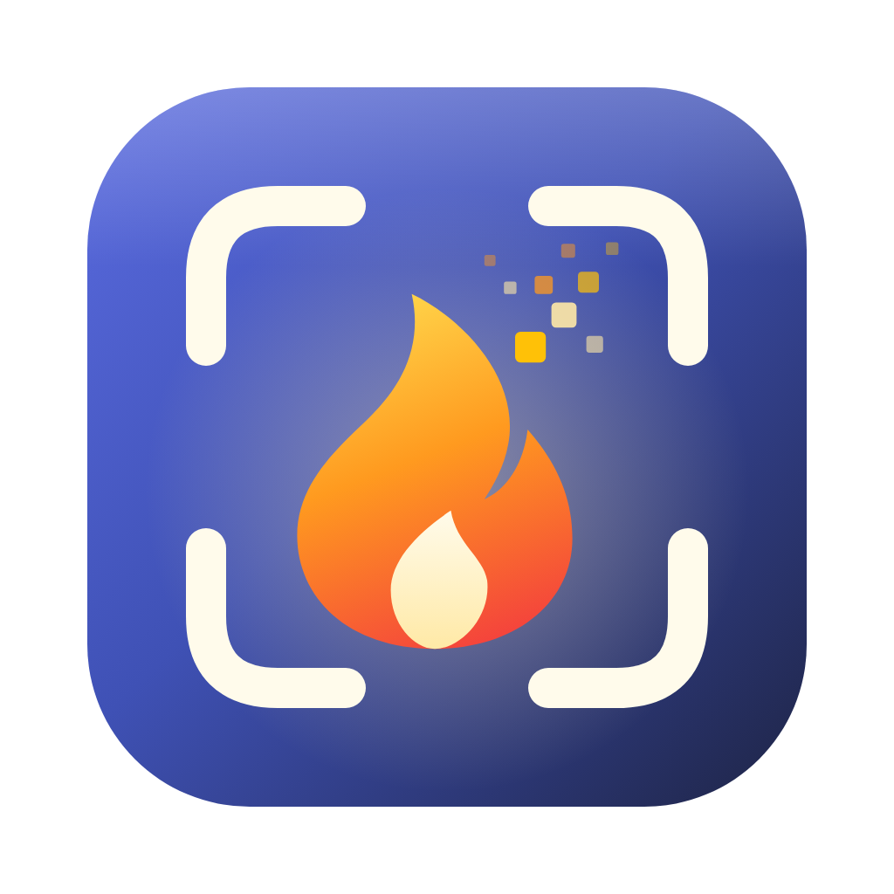
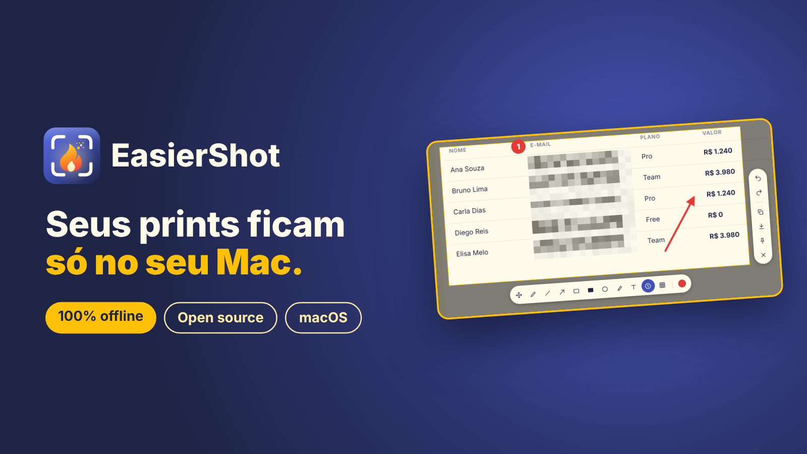
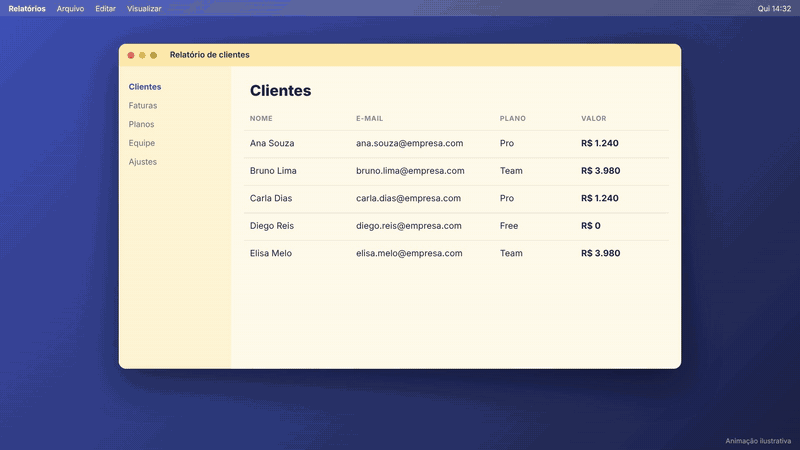
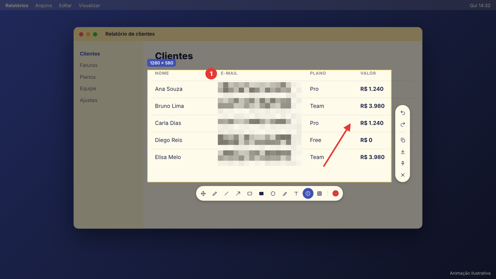
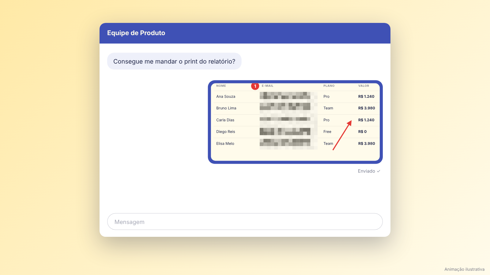

<div align="center">



# EasierShot

**Captura de tela nativa para macOS, com edição na hora e 100% offline.**

Selecione, anote, pixele o que é sensível e copie. Nada sai do seu Mac.

[](#requisitos)
[](#compilar-a-partir-do-código)
[](#-privacidade)
[](#código-aberto-e-direitos-autorais)
[](https://github.com/HygorM10/easier-shot/releases)

<br>



</div>

<br>

## ⚡ Instalação rápida

```bash
curl -fsSL https://raw.githubusercontent.com/HygorM10/easier-shot/main/install.sh | bash
```

O script baixa o `.dmg` da [release mais recente](https://github.com/HygorM10/easier-shot/releases),
instala o app em `/Applications` e mostra o progresso do download. Ao final, abra o
EasierShot pelo Finder ou pelo Launchpad.

O app fica na barra de menus (ícone de moldura com uma chama). Na primeira captura o macOS
pede a permissão de **Gravação de Tela**; autorize em Ajustes do Sistema › Privacidade e
Segurança e reabra o app.

> As versões atuais são builds ad hoc e podem exigir autorização em **Privacidade e
> Segurança** do macOS.

## 🎬 Como funciona

<div align="center">

</div>

<br>

| 1. Capture | 2. Edite | 3. Copie |
| :---: | :---: | :---: |
| Pressione `⇧⌘2` e arraste para selecionar a área | Setas, formas, texto, contador e pixelar | `⌘C` ou `Enter`, e cole onde quiser |

<table>
<tr>
<td width="50%"></td>
<td width="50%"></td>
</tr>
<tr>
<td align="center"><sub>Edição direto sobre a captura, com as barras de ferramentas ao redor da seleção</sub></td>
<td align="center"><sub>O print editado vai para a área de transferência, sem salvar nenhum arquivo</sub></td>
</tr>
</table>

<sub>As imagens acima são ilustrativas.</sub>

## 🔒 Privacidade

**O EasierShot não salva nem envia suas imagens para a nuvem ou para qualquer outro
servidor. Todo o processamento é local e seguro, na sua máquina.**

- O app não contém nenhum código de rede: não faz upload, não coleta dados de uso e não
  se conecta à internet.
- A captura existe apenas na memória até você decidir o que fazer com ela: copiar para
  a área de transferência, salvar em um arquivo no local que você escolher ou fixar na tela.
- Se você cancelar (`Esc`), a captura é descartada.
- O código é aberto: qualquer pessoa pode conferir.

## ✨ Recursos

| | |
| --- | --- |
| 🖥️ **Captura** | Seleção de área na tela em que você está trabalhando; mova e redimensione pelas alças |
| ✏️ **Edição** | Lápis, linha, seta, retângulo, retângulo preenchido, elipse, marca-texto, texto, contador numerado e pixelar |
| 🎨 **Ajustes de traço** | Cores e espessura no ponto de cor da barra ou pela rolagem do mouse; desfazer e refazer |
| 📋 **Copiar** | Direto para a área de transferência, sem salvar em disco (`⌘C` ou `Enter`) |
| 💾 **Salvar** | Em PNG, no local que você escolher (`⌘S`) |
| 📌 **Fixar** | Mantém a captura na tela em uma janela flutuante |
| 🌗 **Aparência** | Tema claro, escuro ou do sistema |
| 🌎 **Idiomas** | Português e inglês |
| 📡 **Sem rede** | O app não faz nenhuma conexão com a internet |

Com mais de um monitor, a captura acontece apenas na tela que está em foco no momento do
atalho.

## ⌨️ Atalhos

| Ação | Atalho |
| --- | --- |
| Capturar tela (global) | `⇧⌘2` |
| Copiar | `⌘C` ou `Enter` |
| Salvar | `⌘S` |
| Desfazer / Refazer | `⌘Z` / `⇧⌘Z` |
| Alterar espessura | Rolagem do mouse |
| Cancelar | `Esc` |

## Requisitos

- macOS 14 (Sonoma) ou superior
- Xcode 15 ou superior (apenas para compilar)

## Compilar a partir do código

Gerar o `EasierShot.app`:

```bash
./build-app.sh
```

Abrir o app:

```bash
open build/EasierShot.app
```

Também é possível abrir o `Package.swift` no Xcode e executar por lá. Nesse caso o programa
roda como um executável solto, sem o pacote `.app`, e por isso aparece **sem ícone** no
Dock e na lista de Gravação de Tela dos Ajustes do Sistema. Para ver o ícone colorido,
use o `EasierShot.app` gerado pelo `build-app.sh` ou instalado pelo `.dmg`.

### Gerar o instalador (.dmg)

```bash
./make-dmg.sh
```

O resultado é `build/EasierShot.dmg`. Há duas formas de instalar:

- **2 cliques**: duplo clique no `.dmg` e duplo clique no EasierShot. Ele pergunta se
  deve se instalar, copia-se para Aplicativos, reabre de lá e ejeta o disco.
- **Arrastar**: duplo clique no `.dmg` e arraste o EasierShot para a pasta Aplicativos.
  O disco é ejetado automaticamente na primeira vez que o app instalado for aberto.

### Publicar uma versão

Crie e envie uma tag no formato `v1.0.0`:

```bash
git tag v1.0.0
```

```bash
git push origin v1.0.0
```

Isso dispara o workflow do GitHub Actions e cria a release automaticamente. Para
distribuição pública sem o aviso do macOS, será necessário configurar assinatura
Developer ID e notarização da Apple no GitHub Actions.

## Código aberto e direitos autorais

O EasierShot é um projeto de código aberto, disponibilizado sob a
[Licença MIT](https://opensource.org/licenses/MIT). Sugestões e contribuições são
bem-vindas.

Copyright (c) 2026 HygorM10.
